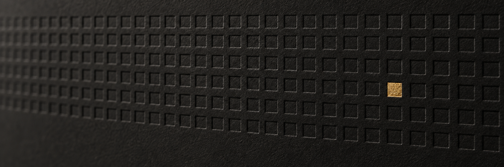

### You can't buy the launch. You mine it.

The First Nonce is a Solana launchpad where a new coin's opening supply can only be mined with proof-of-work. For the first few minutes the only way in is to hash. 200 wallets don't hash any faster than one, so bundles and snipers get nothing extra. When the dig ends, the coin opens on a Meteora pool that can't trade below its opening price.

```
share = keccak256(challenge ‖ wallet ‖ nonce)    valid if first 8 bytes < target
```

| | |
|---|---|
| Program | [`GUW16mLqFWfGjD5AFFSwDxQyGAFSDvPdEbryVa98TGs3`](https://solscan.io/account/GUW16mLqFWfGjD5AFFSwDxQyGAFSDvPdEbryVa98TGs3) |
| Config | [`B665MTTAmazzvki2NUcxyfz3yorq5LTvARWngyNRNsN5`](https://solscan.io/account/B665MTTAmazzvki2NUcxyfz3yorq5LTvARWngyNRNsN5) |
| Treasury | [`Hond8uF8MfJHJQ9xcy6GNc2zCffaTXgG4T5TP3NWs6Lt`](https://solscan.io/account/Hond8uF8MfJHJQ9xcy6GNc2zCffaTXgG4T5TP3NWs6Lt) |
| Upgrade authority | [`Ayq6tRC3atGKuKP6wdt4fX1fSBe1wnBrzMAkCxMatCbG`](https://solscan.io/account/Ayq6tRC3atGKuKP6wdt4fX1fSBe1wnBrzMAkCxMatCbG) |

The on-chain program is in [first-nonce-program](https://github.com/thefirstnonce/first-nonce-program), built reproducibly so anyone can check the deployed binary matches the source. Unaudited and upgradeable.
